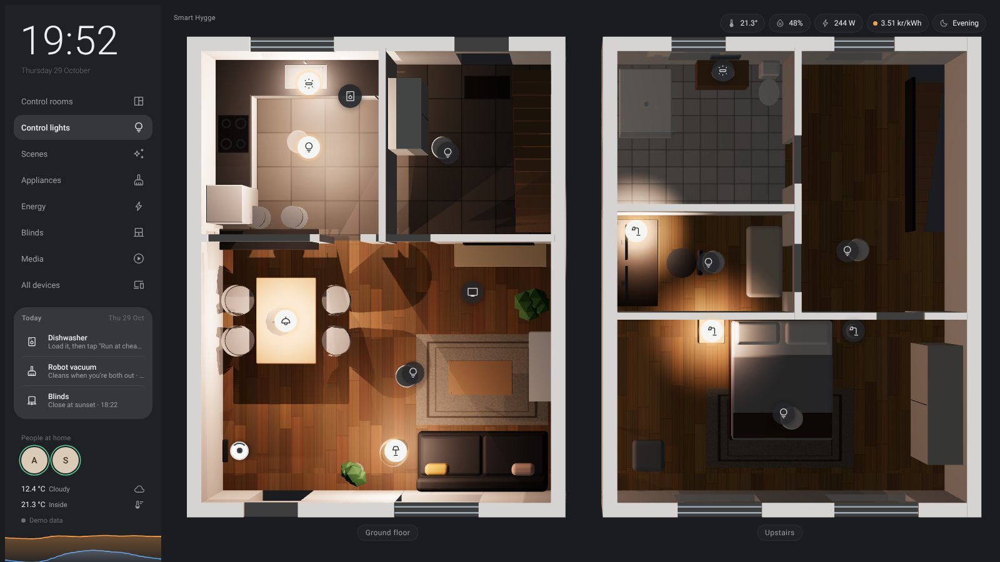
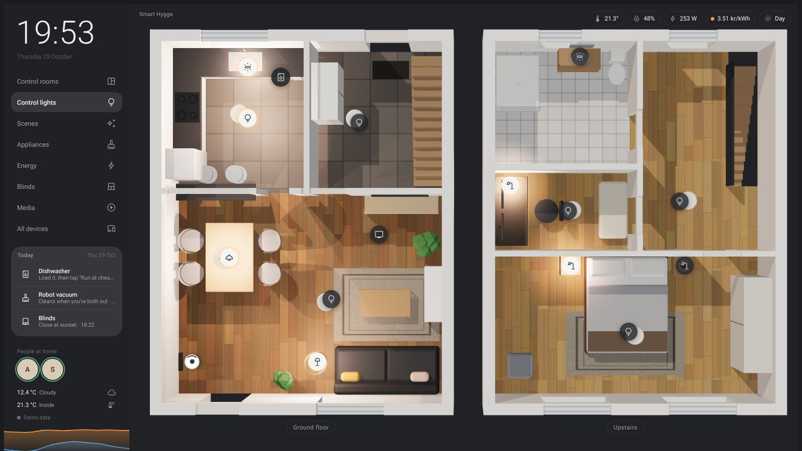
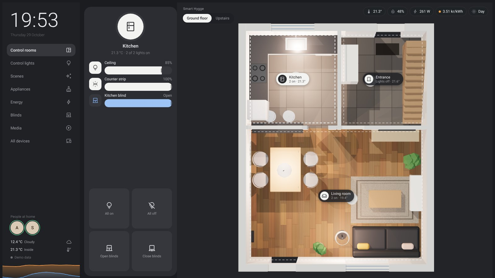
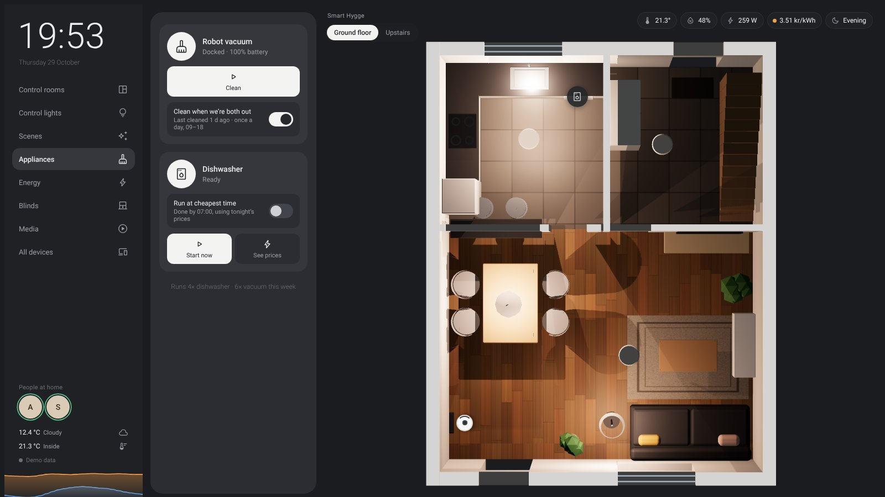
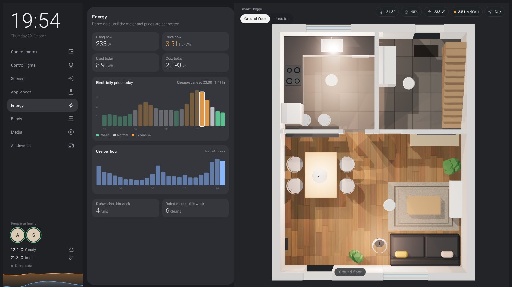
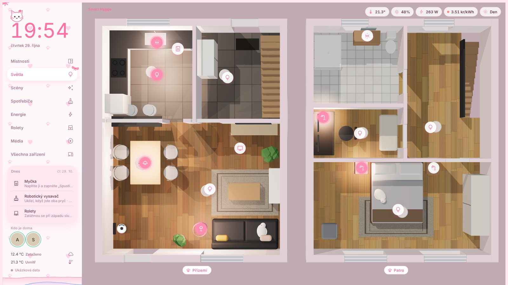

# Smart Hygge

A wall-panel dashboard for a smart home, backed by Home Assistant. It shows the home as a live 3D floorplan
(in the style of [lukevink/hass-config-lajv](https://github.com/lukevink/hass-config-lajv)) with real light
pools that follow the IKEA lights, plus blinds, the TV, the Xiaomi robot vacuum and dishwasher, and energy prices.



| | |
|---|---|
|  |  |
| **Daytime.** The house follows the sun; rooms with closed blinds go darker. | **Control rooms.** Tap a room for its lights and blinds. |
|  |  |
| **Appliances.** Vacuum when you're out, dishwasher at the cheapest hours. | **Energy.** Today's price per hour, use, and cost. |
|  | |
| **Personal themes.** Each user can get their own look and language, like this pink kawaii theme in Czech. | |

*Screenshots use demo data and a fictional demo house. Change the rooms, lights and furniture in
`dashboard/src/config/home.ts` and `dashboard/src/scene/house.ts` to match your own home.*

## How it fits together

```
  IKEA TRÅDFRI gateway ─┐
  Xiaomi Home (cloud) ──┤
  Energi Data Service ──┼──►  Home Assistant  ──WebSocket──►  Dashboard (this repo)
  Phones (Companion) ───┤     (Hyper-V on the PC        │      served by HA at /local/smarthygge/
  TV, router, sensors ──┘      now, Raspberry Pi later)  │
                                                         ├─► Chrome start page on the PC
                                                         ├─► Phones and laptops on the home Wi-Fi
                                                         └─► Kitchen tablet (Fully Kiosk) later
```

- **Home Assistant is the brain.** Devices, automations (dishwasher at the cheapest hours, vacuum when you're
  both out, blinds at sunset), history and statistics all live there, so they keep working without the dashboard.
- **The dashboard is only a view.** It reads state over HA's WebSocket API and calls HA services. It can't break
  anything, and replacing or redesigning it never touches the automations.
- **New devices are added gradually.** Every device in `dashboard/src/config/home.ts` runs on demo data until an
  entity with that id exists in HA, then switches to the real thing on its own. In live mode, simulated devices
  are tagged "demo" so you can see what's left to connect.

## Repository

| Path | What it is |
|---|---|
| `dashboard/` | The panel: Vite + TypeScript + three.js. `src/config/home.ts` is the one file to edit when devices change. |
| `homeassistant/packages/smarthygge.yaml` | Helpers, scenes and automations the panel uses. |
| `homeassistant/custom_templates/smarthygge.jinja` | Cheapest-price-window macro shared by the automations. |
| `docs/` | Step-by-step setup: Home Assistant, integrations, access for everyone, kiosk, moving to the Pi. |
| `scripts/setup-hyperv.ps1` | One-shot Hyper-V setup of Home Assistant OS on the PC. |
| `chrome-newtab/` | Tiny Chrome extension that opens the dashboard in every new tab (chrome://extensions → Developer mode → Load unpacked). |

## Quick start

```bash
cd dashboard
npm install
npm run dev
```

Opens on http://localhost:5173 with demo data. To connect it to Home Assistant once it's running:
http://localhost:5173/?ha=http://homeassistant.local:8123 (you're sent to HA's login once, then remembered).

Address options (combine with `&`): `?view=rooms|scenes|appliances|energy|blinds|media|devices`,
`?room=kitchen`, `?sun=day|night`, `?date=06-21` (the sun demo plays that day), `?theme=kawaii|default`, `?lang=cs|auto`, `?frame` (tablet mockup frame).

## Setup guides

1. [Install Home Assistant on the PC (Hyper-V)](docs/01-install-home-assistant.md)
2. [Connect the devices and add the automations](docs/02-integrations.md)
3. [Put the dashboard in Home Assistant, set it as the Chrome start page, give the household access, kiosk tablet](docs/03-dashboard-access.md)
4. [Move from the PC to the Raspberry Pi](docs/04-move-to-raspberry-pi.md)
